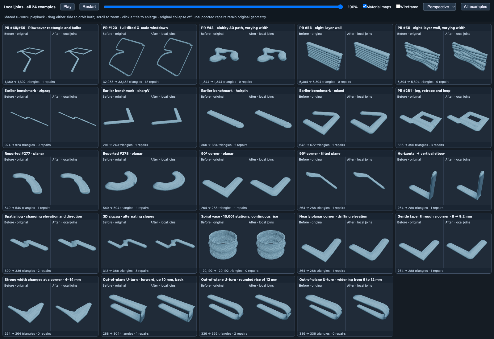
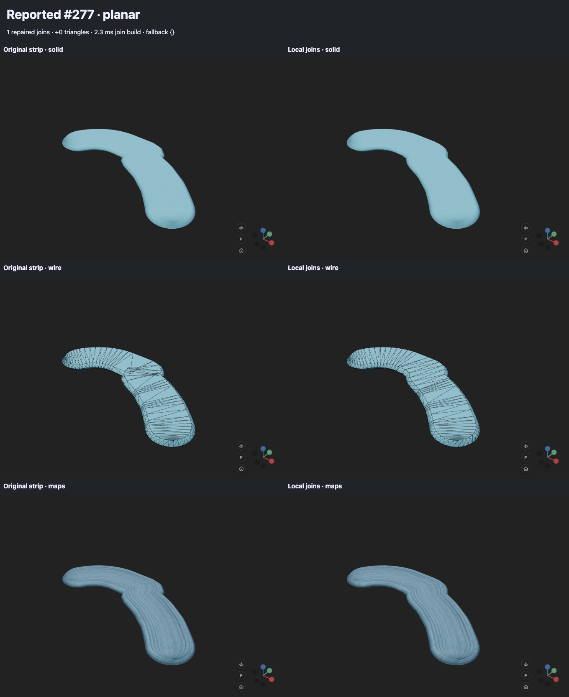
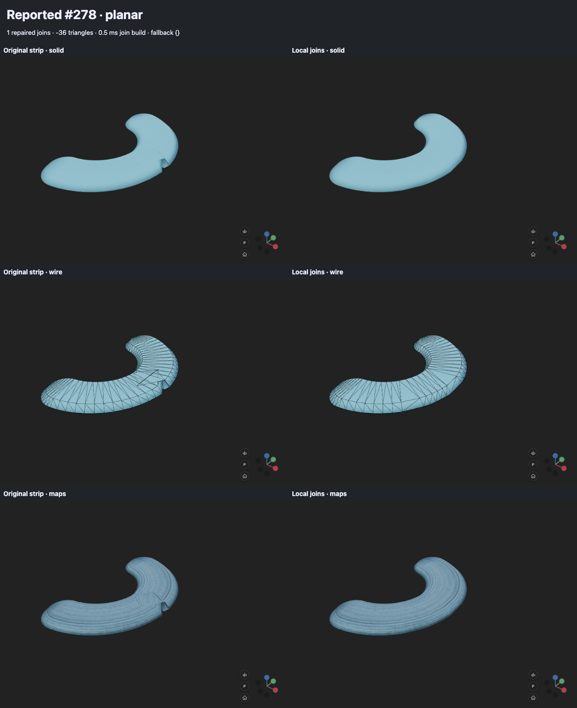
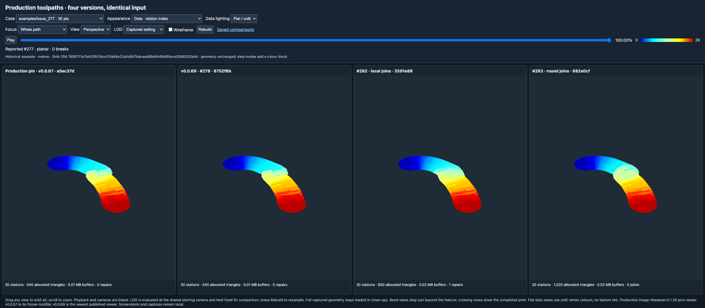
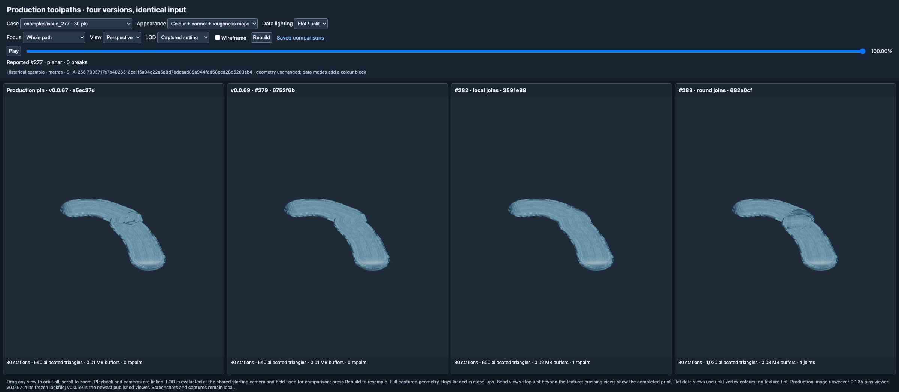

# Bounded local tube joins

Use `add_parametric_tube(..., surface="local_join")` to opt in. The default ring renderer is unchanged. Color, normal, and roughness maps are supported, including the existing wrapped path-distance UVs. This is a best-effort surface renderer, not a watertight solid-union operation across an entire print.

## Construction

- Smooth bends whose miter displacement is below the tolerance retain their original geometry. The default tolerance is local width / 100.
- An isolated corner trims its inner offsets and samples its outer arc. Its section is transported around the actual 3D bend axis. It replaces two ring pairs, reuses the exact boundary rings, and costs at most 96 triangles.
- A short almost-planar jog or reversal can become one bounded cluster, up to ten segments. Analytic transverse slices of the segment capsules give the outer and top outlines. Each sample retains the six-vertex chamfered section. Disconnected slices, incompatible interfaces, large section changes, and over-budget patches fall back to the original strip. There is no polygon clipping or general-purpose Boolean dependency.
- Cluster planarity is local and tolerant: residual rise after subtracting the endpoint slope may be up to 10% of bead height plus 0.2% of width. Actual elevations are interpolated back into the mesh. A spiral vase does not need to fit a single plane.
- Clusters have at most 192 triangles and may add at most 96 over the replaced strip. The whole object has an additional-triangle budget of `max(96, ceil(original_triangles * 0.15))`. Once exhausted, later candidates retain the original strip.

The isolated-arc tolerance is a chord tolerance. Cluster sample spacing is a geometric heuristic, **not a certified Hausdorff-error bound**. Other layers and distant self-intersections are not unioned. The spatial-jog example deliberately retains an unsupported tight bend; adjacent repairs are not allowed to overlap. Large changes of section, near-vertical incoming frames, or patch frames pointing opposite to the original interface frames also fall back.

## Playback, storage, and maps

Construction is a single linear scan with bounded work per candidate. Smooth stations are classified without vector allocations. Accepted patches are built once into compact, independent vertex and index buffers, copying only their interface vertices. The original strip buffers are never enlarged or duplicated. A binary search selects the completed patches during playback. Only windows crossed since the previous update are masked with degenerate indices or restored for backward seeks. Nearby index uploads are batched, with a 256 KiB batch cap and at most four times the changed indices uploaded. CPU backups contain only those windows; there are no per-station prefix tables. Playback costs a binary search plus work proportional to crossed patch windows, so a full backward seek costs more than an ordinary frame. No patch triangles are rebuilt each frame.

A patch becomes visible after its entire window is behind the frontier. Until then, that bounded region uses the existing animated strip and cap. This can produce a visible transition: the unresolved region is up to ten segments long, not necessarily completely hidden by the nozzle overlay. New joins are not progressively Boolean-unioned while the head is inside their window.

Outside patches, positions and UVs are unchanged. Within isolated joins, texture distance advances around the outer arc and the inner trim shares one coordinate. Within clusters, distance is interpolated monotonically across the window; this deliberately smooths texture flow through small reversals and may stretch the material. The original dual-wrapped UV representation is retained.

Objects with repairs add one patch mesh. Objects with no repairs allocate no additional GPU geometry. Because masked strip indices are still submitted as degenerate triangles, a second budget limits **all patch triangles** to `max(192, ceil(original_triangles * 0.15))`, bounding additional submitted indices as well as visible triangle growth. The table below reports nondegenerate surface triangles, not GPU submissions.

LOD is supported: repairs are rebuilt on each active reduced spine, with breaks and original-index playback timing preserved. Old patch buffers and wire-overlay materials are disposed on replacement. Worker responses continue checking the remaining tubes after the camera stops; a two-tube regression verifies actual zoom-out/zoom-in rebuilds and transferred break masks in Chromium and Firefox. Patch construction runs on the main thread after the worker supplies the reduced strip, so a dense repair-heavy rebuild can still pause interaction. Strand collapse remains disabled. Explicit orientations remain unsupported. Uniform and per-station colors, runtime color updates/resets, and all three texture maps work. Patch vertices retain an eight-byte source-station/interpolation record. Isolated rounded corners take the corner station’s color; cluster boundary vertices interpolate the source segment that produces that envelope edge. Interface vertices retain their original station color. This adds no vertices or triangles and requires no geometry rebuild for color changes. Updates also refresh break caps, preserve the paused frontier, and supersede stale LOD worker colors.

## Captured results

All captures use the actual viewer. Left is the original strip with strand collapse off; right is local joins. Rows show solid shading, wire overlay, and color + normal + roughness maps.

| Case | Original triangles | Result | Comparison |
|---|---:|---:|---|
| #277 tight S-jog | 540 | 540 | [Screenshot](media/local_joins/issue_277_comparison.png) |
| #278 reversal | 540 | 504 | [Screenshot](media/local_joins/issue_278_comparison.png) |
| Planar 90° corner | 264 | 288 | [Screenshot](media/local_joins/planar_corner_comparison.png) |
| Tilted 90° corner | 264 | 288 | [Screenshot](media/local_joins/tilted_corner_comparison.png) |
| Vertical elbow | 264 | 280 | [Screenshot](media/local_joins/vertical_elbow_comparison.png) |
| Spatial jog | 300 | 336 | [Screenshot](media/local_joins/spatial_jog_comparison.png) |
| Spatial zigzag | 312 | 366 | [Screenshot](media/local_joins/spatial_zigzag_comparison.png) |
| 10,001-station spiral vase | 120,192 | 120,192 | [Screenshot](media/local_joins/spiral_vase_comparison.png) |
| Rising corner | 264 | 288 | [Screenshot](media/local_joins/rising_corner_comparison.png) |
| Gentle width taper, 8 → 9.2 mm | 264 | 288 | [Screenshot](media/local_joins/width_gentle_comparison.png) |
| Strong width changes, 4–14 mm | 264 | 264 (fallback) | [Screenshot](media/local_joins/width_abrupt_comparison.png) |
| Forward, up 10 mm, back | 288 | 304 (partial repair) | [Screenshot](media/local_joins/uturn_step_comparison.png) |
| Rounded out-of-plane U-turn | 336 | 352 (partial repair; frame fallback) | [Screenshot](media/local_joins/uturn_round_comparison.png) |
| Widening out-of-plane U-turn, 6 → 12 mm | 336 | 336 (fallback) | [Screenshot](media/local_joins/uturn_taper_comparison.png) |

### Variable widths and out-of-plane U-turns

The width examples supply real per-station width arrays to both renderers. Gentle taper permits the corner repair; the strong taper triggers the existing section-change guard. All U-turns go forward along X, rise along Z, and return along negative X with the default +Z up vector. The rounded versions rise 12 mm along a semicircle of radius 6 mm; the stepped version rises 10 mm through a vertical segment.

The rounded U-turn previously accepted three patches and introduced a pronounced twist near its upper return. Recomputing the patch frame from `up × tangent` gave the opposite orientation to the original transported frame. A new interface-frame guard rejects that patch; its upper-return triangles now remain exactly original. Two other patches remain (336 → 352 triangles). This removes the large added twist, but does **not** solve all bend seams or make the U-turn a clean swept surface. The stepped U-turn still retains its vertical-frame seam, and the widening U-turn falls back. These fallbacks remain part of the opt-in renderer’s documented contract.

### Reused earlier examples and synchronized overview

The first five tiles are the recovered, more complex historical paths. Their inputs are frozen in [`bench/tube_lab/fixtures`](../bench/tube_lab/fixtures/README.md), with provenance and all original stations, widths, heights, up vectors, and anchors retained.

| Earlier complex case | Stations | Original → local triangles | Repairs | Comparison |
|---|---:|---:|---:|---|
| #49/#50 Ribweaver rectangle and bulbs | 100 | 1,380 → 1,392 | 1 | [Screenshot](media/local_joins/pr49_bulbs_comparison.png) |
| #120 full tilted G-code winddown | 2,734 | 32,988 → 33,132 | 12 | [Screenshot](media/local_joins/pr120_winddown_comparison.png) |
| #43 blobby 3D path, variable width | 97 | 1,344 → 1,344 | 0 | [Screenshot](media/local_joins/pr43_blobby_comparison.png) |
| #56 eight-layer wall | 427 | 5,304 → 5,304 | 0 | [Screenshot](media/local_joins/pr56_wall_const_comparison.png) |
| #56 eight-layer wall, variable width | 427 | 5,304 → 5,304 | 0 | [Screenshot](media/local_joins/pr56_wall_vary_comparison.png) |

These cases reveal limited repair coverage: the blobby shape and both wall variants remain unchanged, and most difficult bulb sites fall back. The #49 input is the historical reduced reproduction, not the full source dump. The #120 case includes the entire retained G-code snippet. No paths were resampled to make the algorithm look better. These historical images use the shared mapped comparison material. The production comparison below additionally exercises per-station colors.

The gallery also uses the exact four scene generators from `bench/tube_lab/zr_metric.py`, previously used for PR #279/#280: rounded jittered zigzag with variable widths/heights, sharp V, tight hairpin, and mixed sparse corner/dense arc. The jog/retrace/loop path is copied from PR #281's `examples/39_planar_swept_union.py` at `05e85ef`. These compare the current original strip (collapse off) with local joins; they do not run the old PR renderers.

| Historical path | Original → local triangles | Comparison |
|---|---:|---|
| Rounded zigzag | 924 → 924 | [Screenshot](media/local_joins/prior_zigzag_comparison.png) |
| Sharp V | 216 → 240 | [Screenshot](media/local_joins/prior_sharpV_comparison.png) |
| Tight hairpin | 360 → 384 | [Screenshot](media/local_joins/prior_hairpin_comparison.png) |
| Mixed sparse/dense bends | 648 → 672 | [Screenshot](media/local_joins/prior_mixed_comparison.png) |
| PR #281 jog/retrace/loop | 336 → 396 | [Screenshot](media/local_joins/prior_union_demo_comparison.png) |

The historical examples expose remaining limits: the smoothness gate leaves the zigzag's inner folds untouched, the tight hairpin still overlaps, and the retraced/overlapping sections of the PR #281 path are not unioned. A repair count is not a visual-quality score.

`python bench/tube_lab/local_joins.py --demo-only` builds both interactive pages without capturing screenshots. Serve `bench/tube_lab/out/local_joins` and open `overview.html` for all **24 examples**, each with original and local joins side by side. All 48 objects share a 0–100% slider and looping playback (ten seconds printing, two seconds held at completion). Each pair shares a camera: drag either side to orbit, scroll to zoom, or select top/side/perspective. Click a title to enlarge that pair; Escape or “All examples” returns to the grid. Material-map and wireframe switches apply to every example. One WebGL context renders the whole grid with separate viewports.

Run `python bench/tube_lab/local_joins.py --case uturn_round --case width_gentle` to refresh selected captures while retaining the existing gallery, or omit `--case` to regenerate the gallery, metrics, and interactive `out/local_joins/demo.html`. The demo supports case selection, animation/scrubbing, original/repaired geometry, maps, and wire overlay. Serve that directory with a local HTTP server. Three.js still loads from the viewer's normal CDN.

## Scale checks

`python bench/tube_lab/local_join_scale.py` compares original and local rendering at 1,001, 10,001, and 100,001 stations, with and without maps. Raw results are in `bench/tube_lab/local_join_scale_results.json`.

At 100,001 stations (1,200,192 triangles), both renderers use 28,804,752 geometry-buffer bytes without maps and 36,005,976 with maps. The current scan took 4–13 ms once in this run. These CPU microbenchmarks exclude GPU rendering, texture memory, upload time, and initial tube construction.

The repaired 100,007-station mapped case adds 48 surface triangles in two patches. Geometry buffers grow from 36,008,136 to **36,011,880 bytes: 3,744 bytes extra**, plus 576 bytes of CPU index backups. The previous implementation added approximately 14.4 MB of geometry buffers and eight CPU bytes per station. Patch storage now depends on repair count, not untouched path length. Local construction took about 11 ms and average CPU draw-range updates about 0.010 ms in this run.

`python bench/tube_lab/local_join_large.py` measures one-million-station mapped paths with GPU timer queries: smooth, two-repair, dense-repair, dense-repair with LOD, and repeated #277 jog clusters. It runs three alternating-order trials, one tube/context at a time, at 1280 × 800 and device pixel ratio 1, with shadows off. Each trial records 60 animated frames, sweeping 20–95% completion after warmup. These are animated medians, not timings at 100% completion. The camera, near/far planes and LOD are fixed explicitly. It checks visible draw submissions, WebGL errors, disjoint queries and context loss. Geometry-buffer bytes exclude textures, CPU spine/LOD data and transient allocations; saved patch indices are reported separately. GPU times are rendering measurements, not total application frame times or guarantees for other hardware.

Browser tests cover seam closure, projected top-surface overlap in both reproductions, slight nonplanarity, arbitrary plane orientation, an elbow, playback/backward seeks, all three maps, unchanged outside-patch attributes, stable completed buffers, smooth-spiral triangle count, patch budgets, constant-size sparse storage, LOD zoom out/in, break remapping, and disposal of old patch buffers and wire materials.

Measurements on Apple M1 Pro / ANGLE Metal, Chromium 145.0.7632.6. Values below are medians of three trial medians; MB are decimal geometry-buffer bytes. Raw trials, percentiles and CPU timings are in [`local_join_large_results.json`](../bench/tube_lab/local_join_large_results.json).

| Million-station input | Repairs | Geometry MB, original → local | Animated GPU ms, original → local | Local build ms |
|---|---:|---:|---:|---:|
| Smooth spiral | 0 | 360.006 → 360.006 | 11.42 → 11.48 | 21 |
| Two repairs | 2 | 360.008 → 360.012 | 11.21 → 11.09 | 35 |
| Dense isolated joins | 20,000 | 360.006 → 394.566 | 11.84 → 11.60 | 592 |
| Dense joins + LOD | 2,342 | 19.681 → 23.480 | 3.32 → 3.31 | 107 |
| Repeated #277 clusters | 18,750 | 360.006 → 418.056 | 9.23 → 10.47 | 1225 |

Trial variation exceeds several small differences between surfaces. The large gain comes from retaining LOD: the dense local-join case reduces to 54,654 stations, with geometry buffers falling from 394.6 to 23.5 MB and animated GPU time from 11.60 to 3.31 ms at this camera. CPU patch construction remains synchronous: the full-resolution cluster stress case takes about 1.2 seconds once; the dense LOD case takes about 107 ms. These are startup/rebuild costs, not per-frame remeshing. The cluster case has no net new surface triangles but submits up to 1.8 million additional patch triangles; its masked original slots still consume indices.

All 1,800 measured animation frames completed without WebGL errors, context loss, disjoint timer queries or query timeouts.

Large backward/forward jumps are measured separately with `--seeks --samples 6 --case dense_full --case cluster_full`, using 0/50/99/0.1/100% jumps. Raw final results are in `bench/tube_lab/local_join_seek_results.json`; the recorded pre-batching baseline is in `bench/tube_lab/local_join_seek_unbatched_results.json`. Across three trials, the worst combined CPU range-update and render-submission cost fell from 11.3 to 7.8 ms for dense isolated repairs and from 17.3 to 11.5 ms for clusters. GPU time is recorded separately and must not be added to CPU time as if the two never overlap. Large seeks remain proportional to the crossed repair windows.

## Validation

- Full local suite: 895 tests passed before the final allocation and upload refinements.
- Tube/build/geometry regressions after allocation changes: 102 passed; final local-join regressions after upload batching: 16 passed. Chromium and Firefox local-join suites also passed (31 combined), plus LOD break preservation in both browsers.
- All 325 index/attribute buffers across the 24-case gallery matched byte-for-byte before and after the allocation/budget refinements.
- All 48 overview objects checked at 0/50/100/20% progress, with map/wire switches, enlargement and grid restoration. Screenshots include solid, wire and mapped comparisons.
- TypeScript, tracked-file Ruff checks, generated build and diff checks passed. The PR CI runs the complete final non-browser and browser suites.

## Production captures and per-point colors

`bench/tube_lab/production_compare.py` builds a local four-version comparison using the production captures in `tmp/toolpath_testdata` and the earlier example generators. It reads the original metre-unit tube blobs unchanged; data modes add only the optional packed-color block. The production column uses viewer v0.0.67, pinned by the configured Ribweaver 0.1.35 production image. The other columns are v0.0.69/#279, this PR, and a pinned #283 revision.

Run the generator, then serve `bench/tube_lab/out/production_compare` on localhost port 8767. The interface links cameras and playback and supports material maps, flat or shaded colors by width, height, elevation, layer and station, plus alternating-station diagnostics. `capture_production_compare.py` records screenshots and geometry/playback checks; `--details` adds close-ups and `--case` filters cases. Output and the private input captures stay gitignored. This is a visual/functional comparison, not a GPU benchmark.

The public #277 reproduction below uses the same four pinned builds, left to right: production v0.0.67, v0.0.69/#279, this PR, #283.

Color-support validation at implementation `3591e88` (comparison harness `abc608e`):

- **903 tests passed** in the full local suite; **23 local-join tests passed in Firefox**. This covers color provenance, live updates/resets, paused frontiers, break caps and stale LOD worker responses.
- **212 four-version captures passed**: 60 paths in textured, width-colored and station-colored modes, plus 32 targeted close-ups with textures, width, height and alternating-station colors. Every view was scrubbed forward and backward; checks found no page errors or lost contexts. These are functional checks, not a claim that every depicted surface is visually correct.
- All 60 textured paths retained identical allocated triangle counts, geometry-buffer bytes and accepted repair counts compared with the preceding `36f0caa` local-join implementation. The new eight-byte-per-patch-vertex CPU provenance is additional to those geometry buffers; the performance table above predates this color support.
- Linked orbit/zoom, animation, flat/shaded colors, layer/elevation fields, texture maps, wireframe and full-resolution reloads passed interactive checks. TypeScript, Python lint/format and generated-build consistency checks passed.
