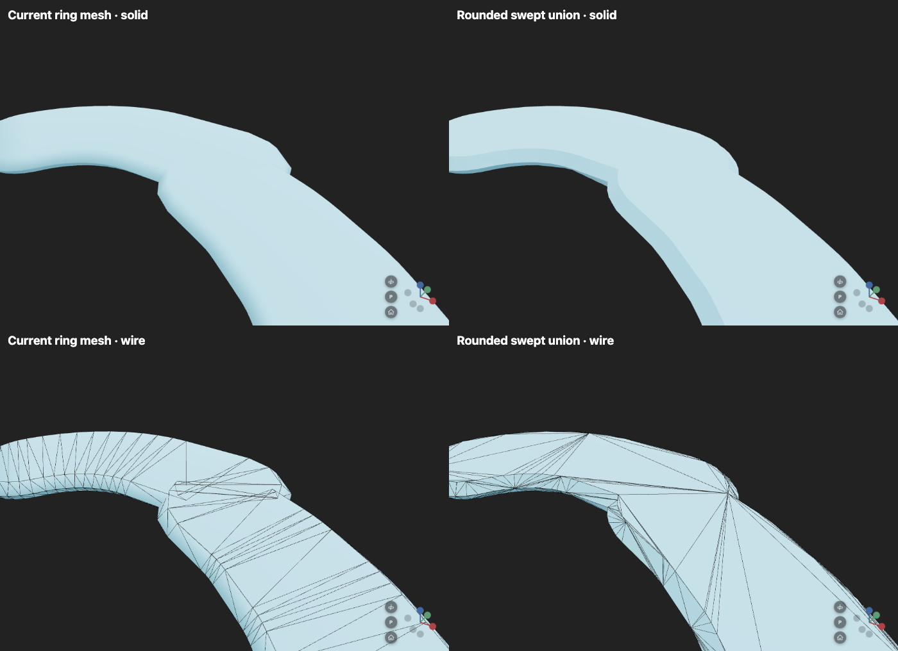
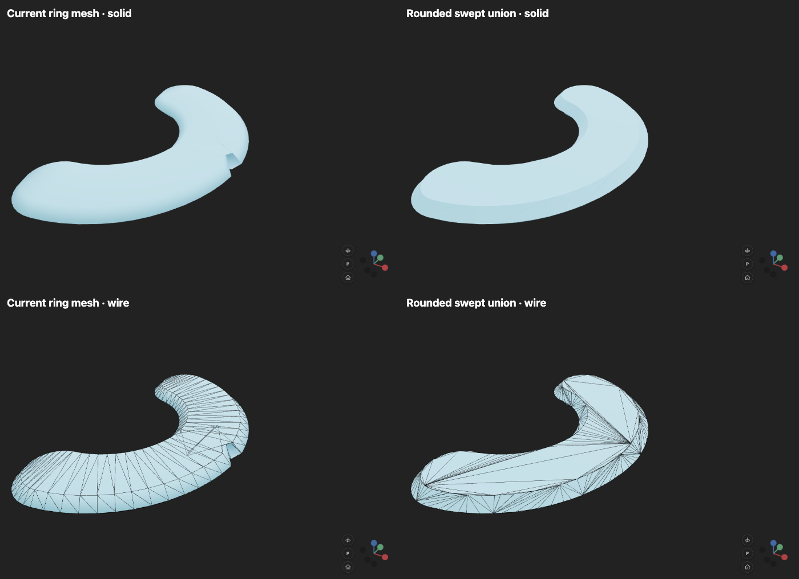

# Planar swept-bead union

The new `surface="planar_union"` option on `add_parametric_tube` replaces
ring stitching with a union of rounded sweeps. It addresses the geometry
behind #277 and #278 without moving the toolpath, collapsing strands,
stretching miters, or adding a deposition-order bias.

```python
viewer.add_parametric_tube(
    "layer", spine, widths, heights,
    surface="planar_union",
    surface_tolerance=0.02,  # outline chord error, in model units
)
```

This first implementation is opt-in. It accepts a plane in 3D perpendicular
to `up_vector`, constant positive height, and widths greater than height.
The ordinary `surface="rings"` renderer remains the default for existing
callers, including nonplanar deposition. A varying-height or nonplanar input
is rejected explicitly; it is not silently flattened into a different shape.

## Geometry

The moving kernel is the existing flat-topped chamfered bead revolved about
its up axis. Its horizontal section at height `z` is a disk of radius
`width / 2 - abs(z)`. This is the moving-ball idea adapted to a flattened
bead, rather than a spherical bead with equal width and height.

1. Project the spine into its plane using an orthonormal basis and local origin.
2. Sweep polygonal disks along each segment. The convex hull of the endpoint
   disks also handles linearly varying widths. Circle subdivision is selected
   by an explicit chord-error tolerance (default minimum width / 500).
3. Boolean-union the sweeps at the mid-plane and flat top. Preserve holes and
   disconnected regions. `break_before` suppresses the corresponding sweep.
4. Triangulate the top footprint and the difference between the two contours.
   Prefer diagonals connecting contour levels. Where topology requires
   interior vertices, evaluate their height against the swept-bead field.
5. Mirror the upper surface to close the bottom. Use analytic chamfer normals.

The chamfer between contours is a triangulated approximation; the outline
chord tolerance is **not** a global surface-error bound. No volumetric grid
is retained. Straight collinear stations with linearly varying width are
merged geometrically while retaining their original playback indices.

Polygon booleans use vendored `polygon-clipping` 0.15.7 (MIT); top and band
triangulation use Three.js's `ShapeUtils`. The standalone HTML embeds the
worker and library, so no additional runtime CDN or package installation is
needed.

## Progressive rendering and triangle count

The worker caches the completed-segment unions. A fractional frontier adds
only the traversed part of the current segment; it does not clip a finished
mesh containing future material. Rebuilding the surface handles newly filled
holes and removal of previously exposed walls. Requests are coalesced to
one in-flight build plus the latest requested prefix.

Forward playback may lag behind the requested position. Backward seeks hide
stale future geometry until the requested prefix arrives. The cylindrical
head overlay can obscure some frontier differences, but correctness does not
depend on that overlay. Completed material is an ordinary indexed mesh whose
triangle count follows its outline, rather than its input station count.

Current cost limits: booleans run in a worker, but triangulation and normal
construction run on the main thread. Each accepted prefix replaces the
visible mesh; completed mesh chunks are not retained across playback frames.
Backward seeks rebuild the prefix cache. This has not been validated as a
replacement for the million-point LOD renderer.

## Validation and comparisons

Run:

```sh
uv run pytest tests/test_planar_union.py --browser chromium
uv run python bench/tube_lab/planar_union.py
```

Tests cover both issue reproductions, closed surfaces, an independent
swept-disk coverage oracle (including overlap counts), retained holes,
changing hole topology between height contours, retraces, duplicate points,
varying widths, oblique planes, height anchoring, breaks, fractional forward
and backward playback, empty output, rapid seeks, wire overlays and disposal.
The old ring silhouette is a comparison image, not the correctness oracle.

At the default tolerance:

| Input | Ring mesh | Swept union |
|---|---:|---:|
| #277, 30 stations | 540 triangles | 632 triangles |
| #278, 30 stations | 540 triangles | 662 triangles |
| Straight, 2 stations | 204 triangles | 224 triangles |
| Straight, 1,001 stations | 12,192 triangles | 224 triangles |
| Straight, 10,001 stations | 120,192 triangles | 224 triangles |

One local Chromium/headless run measured initial worker/meshing times of
20.8/7.2 ms (#277) and 22.4/3.5 ms (#278). Across the tested prefixes, worker
computation took 0.7–6.3 ms and main-thread meshing 1.0–4.1 ms. End-to-end
prefix latency was 7.7–91.1 ms, including scheduling/rendering; this is not a
claim of guaranteed 60 fps. Raw results are in
[`planar_union_results.json`](../bench/tube_lab/planar_union_results.json).
`examples/39_planar_swept_union.py` provides an interactive playback comparison.

The small repros trade about 17–23% more triangles for the rounded envelope.
Dense straight runs demonstrate the different scaling behavior; they do not
predict savings on every curved path. Measured timings are recorded by the
benchmark alongside the images; worker time and main-thread meshing time are
reported separately from end-to-end playback latency.





## Current scope

- Constant bead height within one planar object; arbitrary plane orientation
  and variable widths are supported.
- Uniform material color. Per-station colors, textures, and explicit frame
  orientations are not supported. Per-station color updates warn and leave
  the material unchanged.
- Union is within one object, including disconnected runs separated by breaks.
  Distinct objects/layers are not boolean-unioned together.
- Existing ring LOD, strand collapse, and deposition bias do not apply to this
  mode. The outline tolerance controls subdivision.

A future general 3D sweep needs a local volumetric or boundary-representation
method for nonplanar transitions, together with completed-region caching and
surface simplification. This PR establishes a separate geometry model for the
common planar case rather than adding another repair rule to the ring mesh.
